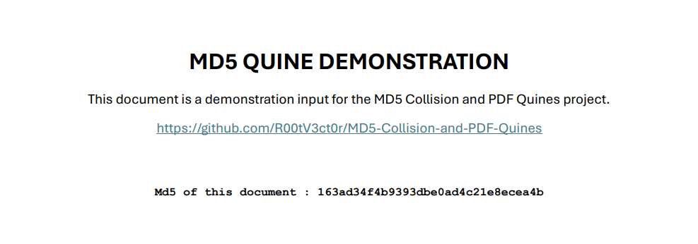
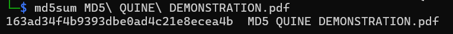

# MD5 Implementation, Collisions and PDF Quines

This repo is a compilation of all the resources that I studied to create my own Python implementation of an MD5 Quine in a PDF.

The current implementation can create an MD5 Quine (a PDF containing its own MD5 hash) from any PDF file containing only one page and fewer than 996 objects, without requiring any additional computation. In practice, this covers almost every single-page PDF file.

> **Important:** ALL the code in this repo is written by me, but the explanations/comments may have been written by AI.

## MD5 Implementation

1. First things first, before understanding collisions, you need to understand how MD5 works. The best way to learn that is to reimplement it yourself, as I did.

   I used these resources to implement it:

   - [MD5 Explained – YouTube](https://www.youtube.com/watch?v=5MiMK45gkTY)
   - [MD5 – Wikipedia](https://en.wikipedia.org/wiki/MD5)

## Collision Attacks

2. Once you really understand MD5, you need to learn more about collision attacks and preimage attacks: what are the differences between them, why is one vulnerable and the other one not?

3. After acquiring this basic knowledge, try to implement a basic brute-force attack to see what the main issues with this method are.

   - `Collision_Attack/0_Brute_force.py`

4. After noticing that there are two main issues with brute-force attacks, namely computation and memory usage, you can try to solve the memory issue since it is much easier than solving the computation issue. For that, you need to learn about Floyd's and Brent's cycle detection algorithms. They both trade memory usage for slightly more computation, which solves the first issue!

   You can find my implementations and explanations (written by AI) directly in the Python files.

   - `Collision_Attack/1_Floyd.py`
   - `Collision_Attack/2_Brent.py`

5. Now that you understand the basic algorithms, it's time to get into the hard part: how MD5 collisions actually work.

   First of all, you need to read `3_How to Break MD5 and Other Hash Functions.pdf`, written by **Xiaoyun Wang and Hongbo Yu**. Take the time to go through all the mathematics step by step to really understand what you are reading. It takes a lot of time, but it's worth it, trust me!

6. Once you fully understand how collision attacks work, it's time to read `4_On Collisions for MD5 - M.M.J. Stevens.pdf` by **M.M.J. Stevens**. You don't need to go through all the mathematics; just read it and understand the mechanism.

> **Important:** The brute-force, Floyd, and Brent scripts implement collision searches on a truncated hash prefix (32 bits by default), not collisions between complete 128-bit MD5 digests. Finding the latter using these generic methods would be computationally impractical.

## PDF Quine

7. Explore the GitHub repo [universal-pdf-md5-collision](https://github.com/adrien1018/universal-pdf-md5-collision) to see how you can create PDF Quines. Play with it, look at the code, and use AI to help you understand how it really works.

   Also, take a look at the first paper to publish an MD5 Quine: [PoC||GTFO 0x14](https://security-bits.de/pocgtfo/pocorgtfo14.pdf).

8. Before implementing your own program, make sure to learn the structure of a PDF file. There are a lot of great resources on the internet. In any case, take a look at these links:

   - [PDF structure diagram](https://github.com/corkami/pics/blob/master/binary/PDF.png)
   - [An introduction to PDF files](https://medium.com/@jberkenbilt/the-structure-of-a-pdf-file-6f08114a58f6)

9. It's time to implement it!!!

   Use the supplied `collisions-1` and `collisions-2` files from the [universal-pdf-md5-collision](https://github.com/adrien1018/universal-pdf-md5-collision) repository to develop your own program.

## Quick Start

### Install dependencies

Install the required Python package:

```bash
pip install pypdf
```

Install qpdf:

```bash
sudo apt update
sudo apt install qpdf
```

> **Note:** This implementation currently works only on Linux because it requires `qpdf` to process PDF files.

### Run the script

```bash
cd PDF_Quine
python 5_MD5_IN_PDF.py input.pdf -o output.pdf
```

The script also accepts `--posx`, `--posy`, `--msg` and `--color` options. Run `python 5_MD5_IN_PDF.py --help` for details.

Make sure to run the script from `PDF_Quine/` so it can find the supplied `collisions-1` and `collisions-2` files.

## Demonstration 

| Generated PDF | MD5 Verification |
|:---:|:---:|
|  |  |

You can also check `MD5 QUINE DEMONSTRATION.pdf` to verify the result.

## License

This project is licensed under the MIT License. See the `LICENSE` file for details.